# Frontier Harness Design Breakdowns — PentAGI

[PentAGI](https://github.com/vxcontrol/pentagi) is the penetration-testing
agent system used for this course's own benchmarking work (see
[E01](../experiments/e01-pallas-model-shootout.md)). Its README documents
its architecture in enough detail to map against the four HCP subsystems
from [L05](../lectures/l05-the-four-subsystems-as-a-protocol.md) — a real
system, not a toy, built by a different team, independently converging on
(and diverging from) the same four concerns.

!!! note "Sourcing"
    Everything below is quoted or closely paraphrased from PentAGI's public
    README as of this writing. This is read-only analysis — nothing here
    was built by or tested against PentAGI's actual code.

## Coverage at a glance

```mermaid
flowchart TD
    subgraph HCP["This course (HCP)"]
        direction LR
        HS[State: StateStore] --- HV[Verification: Verifier] --- HSc[Scope: ScopeEnforcer] --- HL[Lifecycle: SessionLifecycle]
    end

    subgraph Pentagi["PentAGI, as documented"]
        direction LR
        PS["State: Postgres+pgvector,<br/>3 memory kinds — strong"] --- PV["Verification: agent-reported<br/>status + Reflector — weak"]
        PV --- PSc["Scope: Docker sandbox (strong) +<br/>prompt-only target scope (weak)"]
        PSc --- PL["Lifecycle: Orchestrator phases +<br/>Planner/Adviser — strong"]
    end

    HS -.inspired by, more elaborate.-> PS
    HV -.gap PentAGI doesn't close.-> PV
    HSc -.split: infra strong, task weak.-> PSc
    HL -.converges independently.-> PL

    style PV fill:#3a1a1a,stroke:#ef476f
```

PentAGI is stronger than this course's reference implementation on raw
state modeling, comparable on lifecycle, and split on scope — strong at the
infrastructure layer, weak at the task layer. Verification is the clearest
gap: nothing in the documented design closes the "don't trust the agent's
own report" loop that [L03](../lectures/l03-verification-you-can-trust.md)
treats as non-negotiable.

## State

PentAGI's data model is a hierarchy: `Flow → Task → SubTask → Action`, with
`Artifacts` and `Memory` attached to actions. It explicitly separates three
memory *kinds* — long-term (vector store, knowledge base), working (current
context, goals, system state), and episodic (past actions, outcomes,
success patterns) — and persists all of it in PostgreSQL with `pgvector`.

Compare this to [L04](../lectures/l04-context-is-not-free.md)'s CPU/RAM/disk
framing: PentAGI's "working memory" is RAM, its "long-term" and "episodic"
memory are disk, and the distinction is load-bearing enough that they
named it explicitly rather than leaving it implicit in how prompts are
built. Where this course uses one `StateStore` interface
([HCP](../lectures/l05-the-four-subsystems-as-a-protocol.md)), PentAGI uses
a relational+vector schema — more expressive, more infrastructure to run.

## Verification

This is the one subsystem the README doesn't clearly have. Task completion
depends on agent-reported status (`pending/running/done/failed`) and
supervisory agents — a "Reflector" that "guides agents to proper completion
when approaching limits," invoked after repeated failed tool-call attempts.
There's no description of an independent check confirming a reported
finding is actually correct, the way
[L03](../lectures/l03-verification-you-can-trust.md) argues a security
harness needs. This doesn't mean PentAGI's findings are wrong — human
analysts presumably review the "Detailed Reporting" output — but the
*harness itself*, as documented, doesn't close that loop the way this
course's `Verifier` interface does.

## Scope

PentAGI's scope story is split between two layers that this course treats
as one:

- **Infrastructure-level:** "All operations are performed in a sandboxed
  Docker environment with complete isolation," with separate Docker
  networks for core services, monitoring, and analytics, and hard call
  limits (`MAX_GENERAL_AGENT_TOOL_CALLS=100`). This is real enforcement,
  analogous to [AgentCage](../lectures/l02-scope-as-a-security-boundary.md)
  but at the container level instead of the Python-process level.
- **Task-level:** target scope ("stay within the provided target only") is
  enforced through the prompt, not a technical mechanism the README
  describes. That's the gap L02 calls out directly: a scope the agent's own
  reasoning is expected to respect, rather than one enforced below it, can
  be talked out of by exactly the kind of task that's designed to find
  gaps.

One operational detail worth flagging on its own: the README warns that
mounting `DOCKER_SOCKET` "grants an autonomous agent the host Docker API,"
and recommends a hardened dind worker instead — a direct, specific instance
of "enforcement has to sit below the agent's own code" (L02) stated as an
operator warning rather than a harness guarantee.

## Lifecycle

An Orchestrator delegates across phases (research → planning → execution)
to specialist agents (Pentester, Coder, Installer, Searcher, and others).
Two beta features map directly onto lifecycle concerns this course treats
as first-class: a Planner that generates "3–7 specific, actionable steps"
before execution starts (init-time scoping of the task), and an Adviser
"automatically invoked when execution patterns indicate potential issues"
— a checkpoint-triggered intervention rather than the fixed
init/checkpoint/teardown hooks `SessionLifecycle` defines, but recognizably
the same problem: a session needs more structure than "run until done."

## Takeaway

PentAGI converges on state and lifecycle as first-class concerns — more
elaborately than this course's reference implementation, in fact — but
treats scope as mostly infrastructural and verification as mostly
supervisory rather than independent. That's a reasonable set of trade-offs
for a tool whose output is reviewed by a human analyst before anyone acts
on it. It would be a weaker set of trade-offs for the autonomous,
cross-model *benchmarking* use case this course is built around, where
nothing downstream is checking the agent's own report before a score gets
recorded — which is exactly why [HarnessBench](../lectures/l01-why-security-harnesses-are-different.md)
and [EvoBench](../lectures/l06-closing-the-loop-evobench.md) insist on
independent verification as a hard requirement, not an optional layer.
