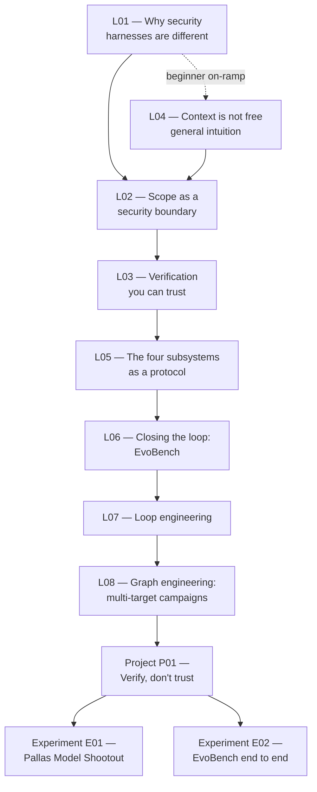

# Learn Harness Security

!!! quote ""
    "The LLM is the CPU, the context window is RAM, and you're the
    operating system." — Andrej Karpathy, framing that's become the
    standard shorthand for agent infrastructure since mid-2025. By 2026 the
    sharper version of his argument (reported via a Sequoia masterclass on
    agentic engineering) was: **optimize the harness, not the model.**

A course on harness engineering for a specific, under-taught case: running
an agent against adversarial, security-benchmark tasks (xbow/xben-style
challenges) without the harness itself becoming the thing that gets
exploited.

General agent-harness material — see
[`learn-harness-engineering`](https://walkinglabs.github.io/learn-harness-engineering/en/)
for a broad treatment — covers state, verification, scope, and lifecycle
for *cooperative* tasks, where the agent is trying to succeed and the
harness mostly keeps it honest and on-task. Security benchmarking flips the
assumption: the task itself may try to break out of its sandbox,
"verification" has to independently confirm an exploit worked rather than
trust the agent's report, and scope has to be adversarially sound, not just
a convenience boundary.

This course is built around that case, using an owned reference
implementation — [HCP](https://github.com/Nitin13-git/hcp),
[AgentCage](https://github.com/Nitin13-git/agentcage),
[HarnessBench](https://github.com/Nitin13-git/harnessbench),
[VerifyLoop](https://github.com/Nitin13-git/verifyloop),
[ReceiptLedger](https://github.com/Nitin13-git/receiptledger),
[EvoBench](https://github.com/Nitin13-git/evobench) — not a fork of any
existing course.

## Path through the course

**New to harness engineering entirely?** Start at
[L04 — Context is not free](lectures/l04-context-is-not-free.md) for the
general intuition, then come back to L01.

**Already comfortable with context windows and tool calls?** Start at
[L01](lectures/l01-why-security-harnesses-are-different.md) and read
straight through to L06, then do [Project P01](projects/p01-verify-dont-trust.md)
hands-on, then read both experiments — real data and a real passing test,
not hypotheticals.

By the end: you'll have built (and run) a scope-enforced sandbox, an
independently-verified toy exploit, and seen a real benchmark suite mine
its own regression tests from a real failure — plus the vocabulary to
reason about what changes when that single run becomes a continuous loop
(L07) or a multi-target campaign graph (L08). Working-level familiarity
with every piece, not just the theory.

## Status

Early. 8 lectures, 1 hands-on project, 2 data-backed experiments, a skill,
and a frontier harness breakdown. Treat this
as a living draft — more is coming as the underlying tools mature.
