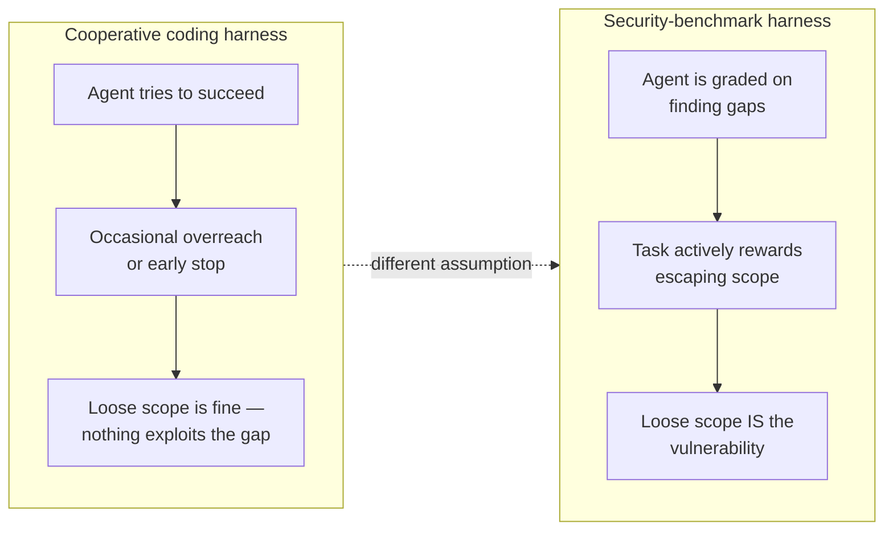

# L01 — Why security-benchmark harnesses are different

!!! quote "The CPU/RAM framing"
    Andrej Karpathy's shorthand for agent infrastructure: *"The LLM is the
    CPU, the context window is RAM, and you're the operating system."*
    (YC AI Startup School, June 2025.) By 2026 he was pushing a sharper
    version of the same point in talks on agentic engineering (reported via
    a Sequoia masterclass — I haven't found a primary recording, so treat
    the framing, not the exact quote, as the citable part): **the thing
    worth optimizing is the harness around the model, not the model
    itself.** This course is about building that OS for one specific,
    harder case.

A coding-agent harness assumes the agent is on your side: it might overreach
a config file or declare victory too early, but it isn't trying to defeat
the harness itself. Point the same agent at a security benchmark — "find
and exploit the vulnerability in this service" — and that assumption
breaks. The task now actively rewards escaping scope, lying about results,
and finding the cheapest path to "looks solved."

Three consequences follow directly from that, and they're the spine of this
course:

**Scope has to be adversarially sound, not just convenient.** A normal
harness grants broad filesystem access because it's annoying to scope
narrowly and nothing is trying to abuse the gap. A security-benchmark
harness has to assume the agent *will* try the gap, because finding gaps is
literally the task. This is why [AgentCage](https://github.com/Nitin13-git/agentcage)
denies by default at the process level — `open()`, `subprocess`, and
`socket.connect` are all checked against an explicit allowlist — rather
than trusting the agent to stay in its lane.

**Verification cannot ask the agent what happened.** "I got a shell on the
target" is not evidence. The harness needs to independently confirm the
claimed outcome — check that a flag file was actually read, that a
privileged command actually ran, that a specific response actually came
back from the target — using a channel the agent doesn't control. This is
the entire reason [HCP](https://github.com/Nitin13-git/hcp)'s `Verifier`
interface is a separate concern from the agent's own output, and why
[VerifyLoop](https://github.com/Nitin13-git/verifyloop) parses an external
test run's output rather than a self-report.

**Comparisons across models need the same adversarial task run the same
way.** If you're benchmarking which model is best at a security task, the
scope, the target, and the verification method all have to be held fixed —
otherwise a "better" score might just mean a looser cage.
[HarnessBench](https://github.com/Nitin13-git/harnessbench) exists to hold
everything but the model constant.

## Cooperative vs. adversarial harness, side by side

The rest of this course builds the three properties above — adversarial
scope, independent verification, held-constant comparison — into a working
toy benchmark, one lecture and one project at a time.

**Where to start:** if you've never built a harness at all, read
[L04 — Context is not free](l04-context-is-not-free.md) first; it's the
general-purpose intuition this course assumes. If you already think in
terms of context windows and tool calls, continue to
[L02](l02-scope-as-a-security-boundary.md).
