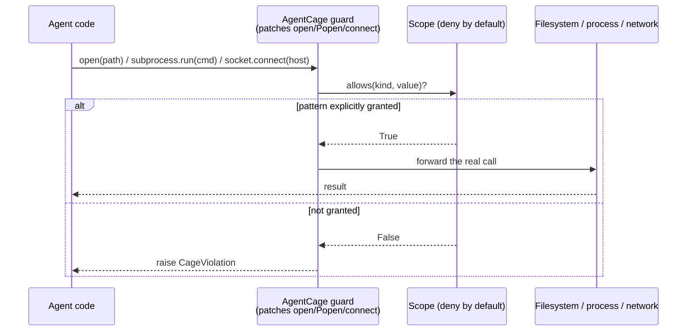

# L02 — Scope as a security boundary, not a convenience

Most harnesses treat "scope" as a UX choice: fewer permissions means more
interruptions, so you grant generously and tighten only when something goes
wrong. That calculus is backwards for a security benchmark, where the task
is specifically designed to find the thing you forgot to restrict.

Two properties make a scope adversarially sound instead of merely
convenient:

**Deny by default.** A scope should start empty and only grow by explicit
grant, never start broad and get narrowed. [AgentCage](https://github.com/Nitin13-git/agentcage)'s
`Scope` has no "allow everything" mode — `scope.allows(kind, value)` returns
`False` for anything not explicitly matched by a granted pattern, full
stop. This matters because a harness author forgetting to add a restriction
is a far more common failure than forgetting to add a grant; deny-by-default
makes the common mistake fail safe instead of fail open.

**Enforcement has to sit below the agent's own code, not inside it.** If the
scope check is something the agent's generated code is expected to call
before acting, the task can just... not call it. `AgentCage`'s guards patch
`builtins.open`, `subprocess.Popen.__init__`, and `socket.socket.connect`
directly — the three points almost everything else in the standard library
funnels through — so the check happens whether or not the agent's own logic
remembers to ask permission.

## How a single request flows through the cage

The agent's own code never gets a vote — the guard sits *below* it, at the
standard-library entry point, so there's no "remember to check scope first"
step for a task to skip.

**A practical exercise:** take a scope granting a target IP on a benchmark
network and nothing else, and verify two things independently: that a
`subprocess.run(["curl", other_host])` call raises `CageViolation`, and that
a call to the granted host still succeeds. If either fails, the scope isn't
actually a boundary — it's a suggestion. Project [P01](../projects/p01-verify-dont-trust.md)
builds exactly this check against a toy vulnerable target.

**Next:** [L03 — Verification you can trust](l03-verification-you-can-trust.md).
