# L03 — Verification you can trust

An agent reporting "I successfully exploited the target and read the flag"
is a claim, not evidence. In a cooperative coding task, trusting that claim
and moving on is usually fine — the agent has little incentive to lie about
whether tests pass. In a security benchmark, the incentive runs the other
way: a model under evaluation gets a better score for *claiming* success,
whether or not it's true, unless something independent checks.

`HCP`'s [`Verifier`](https://github.com/Nitin13-git/hcp/blob/main/src/hcp/verification.py)
interface exists to make this explicit: `run(target) -> VerificationReport`
is a separate call, made by the harness, not the agent, and it returns
`evidence` — not just a boolean — so a human or a downstream aggregator can
audit *why* a check passed or failed without re-running it.

Two patterns make verification trustworthy in practice:

**Verify the side effect, not the transcript.** If the task is "read
`/flag.txt` on the target," don't check whether the agent's final message
contains the string "flag" — check whether `/flag.txt` was actually
accessed, via a mechanism the agent can't fake (a file-access log outside
its scope, a canary value that only appears if the real read happened). The
verification channel has to be something the thing being tested can't
write to. The common weak version of this — checking whether the agent's
*final message* contains the string "success," or asking a second LLM
call to judge the first one's transcript — fails for the same reason a
self-report does: both are still reading something the model under test
produced, just at one remove.

**Capture evidence, don't just capture a verdict.**
[VerifyLoop](https://github.com/Nitin13-git/verifyloop)'s `TestRunResult`
keeps the full output, and `triage()` categorizes *why* something failed —
because "0/10 passed" tells you nothing about whether the harness is broken
or the model is bad, and you need to be able to tell those apart before you
trust a benchmark number at all.

## Self-report vs. independent verification

```mermaid
flowchart TD
    Agent[Agent attempts the task] --> Claim["Agent's own report:<br/>'I read the flag'"]
    Agent --> SideEffect[Actual side effect on the target:<br/>access.log entry written]

    Claim -->|trusted blindly| Wrong[Score recorded —<br/>but claim could be false]
    SideEffect --> Verifier[HCP Verifier reads the<br/>independent channel]
    Verifier -->|evidence-backed| Right[Score recorded —<br/>backed by evidence]

    style Wrong fill:#5c1a1a,stroke:#ff6b6b
    style Right fill:#1a3a1a,stroke:#51cf66
```

Project [P01](../projects/p01-verify-dont-trust.md) wires a
`SubprocessVerifier` against a toy target that only reports success via a
side channel the agent's sandboxed process can't reach, so you can see the
difference between a verified result and a self-reported one concretely.

**Next:** [L04 — Context is not free](l04-context-is-not-free.md).
