# L04 — Context is not free

*This lecture is the general-purpose intuition the rest of the course
assumes. If you already think fluently in terms of context windows, tool
calls, and sessions, skip to [L05](l05-the-four-subsystems-as-a-protocol.md).
If you're new to harness engineering entirely, start here.*

## The CPU/RAM analogy, extended

Karpathy's framing: the LLM is the CPU, the context window is RAM. It's a
good analogy because it predicts something true — RAM is fast but small and
disappears when the process ends. A context window is the same: everything
in it is immediately usable by the model, and all of it vanishes the moment
the session ends (or gets silently truncated once the window fills up).

Push the analogy one step further, because that's where harness engineering
actually lives: **every real computer also has a disk.** RAM is for what
the CPU is working on *right now*; disk is for what has to survive after
the process exits. An operating system's entire job is deciding what goes
in each, and moving data between them deliberately instead of losing it to
a reboot.

A harness is the same decision, made explicitly instead of by accident:

| Computer | Harness |
|---|---|
| CPU | The model |
| RAM | The context window — the current conversation |
| Disk | A durable `StateStore` ([HCP](https://github.com/Nitin13-git/hcp)) — a repo, a ledger, anything outside the context |
| OS deciding what to page in/out | You, deciding what the harness writes to state vs. what it lets the context window hold and forget |

## Why this matters specifically for security benchmarks

A long-running exploitation attempt generates a lot of intermediate
findings: "port 8080 is open," "this endpoint returns a 500 on malformed
input," "auth header X is reflected unescaped." None of that fits
comfortably in a context window forever, and a session that gets
interrupted (timeout, crash, handoff to a different agent) loses anything
that was only ever in RAM.

```mermaid
flowchart LR
    subgraph Session1["Session 1 (RAM only)"]
        F1[Finding: port 8080 open] --> Gone[Session ends —<br/>finding is gone]
    end

    subgraph Session2["Session 2 (RAM + disk)"]
        F2[Finding: port 8080 open] --> Ledger[Written to ReceiptLedger<br/>— durable state]
        Ledger --> Resume[New session reads the ledger —<br/>doesn't re-discover what's already known]
    end

    style Gone fill:#5c1a1a,stroke:#ff6b6b
    style Resume fill:#1a3a1a,stroke:#51cf66
```

[ReceiptLedger](https://github.com/Nitin13-git/receiptledger) is the "disk"
for this course's harness stack: every finding worth keeping gets written
there, hash-chained so it can't be silently edited later, with an index so
reading the current state of any one finding is O(1) regardless of how long
the ledger has grown.

## The exercise

Before continuing, answer this for your own harness, on paper: for a task
that might run for an hour, list three pieces of information the harness
produces that would be expensive to rediscover if the session restarted
halfway through. Those three things belong in a `StateStore`. Everything
else can stay in context and be allowed to disappear.

**Next:** [L05 — The four subsystems as a protocol](l05-the-four-subsystems-as-a-protocol.md).
