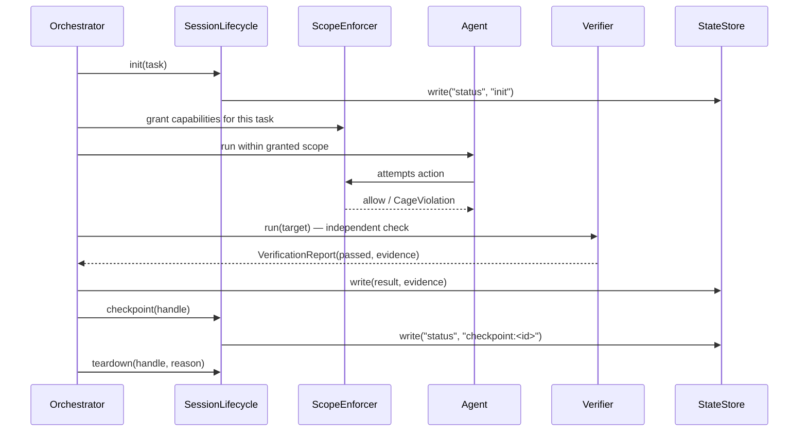

# L05 — The four subsystems as a protocol

L01–L04 covered scope, verification, and state as separate concerns, each
solved by a separate tool. [HCP](https://github.com/Nitin13-git/hcp) (Harness
Context Protocol) is the claim that these aren't three unrelated utilities —
they're four interfaces every harness needs, and standardizing them the way
[MCP](https://modelcontextprotocol.io) standardized tool access means a
harness built for one agent runtime can be reused by another.

The four interfaces, and which lecture introduced the problem each one
solves:

| Interface | Problem it solves | Covered in |
|---|---|---|
| `StateStore` | Durable state that survives a session restart | L04 |
| `Verifier` | Independent evidence instead of a self-report | L03 |
| `ScopeEnforcer` | Least-privilege, enforced below the agent's own code | L02 |
| `SessionLifecycle` | init/checkpoint/teardown hooks so sessions compose | this lecture |

## How one session actually uses all four together



Nothing in this sequence is specific to security benchmarking — that's the
point. The adversarial case this course focuses on just makes every one of
these four interfaces load-bearing instead of optional, because a
cooperative task can get away with skipping most of them and an adversarial
one can't.

## Conformance, not just convention

Because the four interfaces are explicit types
(`hcp.state.StateStore`, `hcp.verification.Verifier`, `hcp.scope.ScopeEnforcer`,
`hcp.lifecycle.SessionLifecycle`), a harness implementation can be checked
mechanically instead of by code review:

```python
from hcp.validator import validate

report = validate({
    "state": my_state_store,
    "verification": my_verifier,
    "scope": my_scope_enforcer,
    "lifecycle": my_lifecycle,
})
assert report.conformant
```

`validate()` doesn't check that your harness is *good* — only that it's
*complete*: every interface is present and correctly typed. Whether your
`Verifier` actually verifies anything trustworthy is still on you (see L03).

**Next:** [L06 — Closing the loop: EvoBench](l06-closing-the-loop-evobench.md).
