# L06 — Closing the loop: EvoBench

Every lecture so far has been about one session: scope it correctly,
verify it independently, keep its state durable. This lecture is about what
happens *across* sessions — specifically, what a harness should do with a
failure after it's found.

The default answer in most benchmarking setups is: nothing. A model fails a
task, the number gets logged, and the next benchmark run uses the same
fixed task list it always does. The failure doesn't change what gets tested
next time.

[EvoBench](https://github.com/Nitin13-git/evobench) is the alternative: a
failure caught by [VerifyLoop](https://github.com/Nitin13-git/verifyloop)
gets mined, automatically, into a new regression task, stored durably in
[ReceiptLedger](https://github.com/Nitin13-git/receiptledger), and from then
on every model benchmarked through [HarnessBench](https://github.com/Nitin13-git/harnessbench)
gets tested against it. The benchmark suite is a byproduct of actually
running the harness, not a document someone maintains separately.

## The full loop

```mermaid
flowchart TD
    Run[Harness run] --> Fail{Verifier says<br/>it failed?}
    Fail -->|no| Done[Nothing to mine —<br/>success needs no regression task]
    Fail -->|yes| Triage[VerifyLoop.triage<br/>categorizes the failure]
    Triage --> Mine[evobench.mine<br/>prompt + bad_output + category]
    Mine --> Store[Suite.add —<br/>ReceiptLedger, hash-chained]
    Store --> Grow[Suite grows by one task]
    Grow --> Bench[HarnessBench runs every<br/>future model against it]
    Bench --> Run

    style Fail fill:#3a2a1a,stroke:#ffa94d
    style Store fill:#1a2a3a,stroke:#4dabf7
    style Grow fill:#1a3a1a,stroke:#51cf66
```

This is the one place in the course where "autonomous" means something
concrete and checkable: no human looks at a failure and decides to write a
benchmark task for it. `observe()` does that step, every time, as a direct
consequence of a verification failing. The compounding effect is the point:
after 50 real failures have been mined, the *next* model you benchmark
isn't checked against one new task — it's checked against all 50, for free,
because `Suite.as_harnessbench_tasks()` reconstructs every mined task from
the ledger on every run. A hand-maintained benchmark grows only when
someone remembers to update it; this one grows as a side effect of the
harness being used at all.

## Why this matters more for security benchmarks than cooperative ones

A cooperative coding harness that fixes a bug once rarely needs a
*permanent* regression test for that exact bug — the fix is in the code,
and code review catches most regressions. A security harness is different:
the same class of vulnerability (an IDOR, a missing auth check, a path
traversal) tends to recur across *different* targets and *different*
models, because it's a pattern in how models reason about access control,
not a one-off typo. A suite that remembers every real failure it has ever
observed is directly useful here in a way it's only marginally useful
elsewhere.

See [Experiment E02](../experiments/e02-evobench-end-to-end.md) for this
loop running against a real (if tiny) failure, with real test output — not
a hypothetical.

**Next:** everything so far has been one run at a time. L07 and L08 cover
what changes when the harness runs continuously and against multiple
targets at once — [L07 — Loop engineering](l07-loop-engineering-for-security-benchmarks.md).
