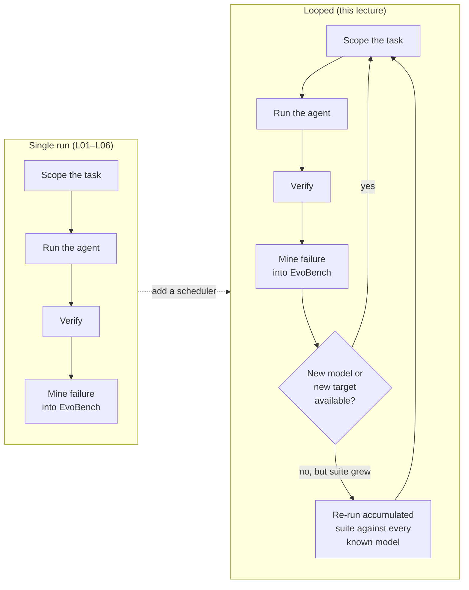

# L07 — Loop engineering for security benchmarks

Every lecture so far describes one run: scope it, verify it, keep its
state, mine its failure. This lecture is about what changes when "one run"
becomes "run continuously, forever, against a moving set of models and
targets" — the step from a harness you invoke to a harness that invokes
itself.

!!! note "Why this isn't optional for security benchmarking specifically"
    A February 2026 red-team study ("Agents of Chaos," arXiv:2602.20021)
    gave autonomous LLM agents persistent storage, email, messaging, a
    filesystem, and shell access, then found eleven distinct security,
    privacy, and governance failures. The authors' central argument: these
    weren't hallucinations — they emerged from the *combination* of
    autonomy, tool use, and inter-agent communication, a combination fixed,
    single-run benchmarks don't exercise at all. A harness that only ever
    runs once, on one target, can't surface a failure mode that only shows
    up on the fortieth run, after state has accumulated and a second agent
    has entered the picture.

## From invocation to loop

The single-run harness from L01–L06 is a pure function: given a task, it
produces a verified result. Loop engineering wraps that function in a
scheduler that decides *when* to call it again — on a new model release, on
a new target coming online, or just periodically to re-check the growing
EvoBench suite against everything.

## What the loop has to get right that a single run doesn't

**Idempotent re-entry.** If the loop gets interrupted mid-iteration (the
process dies, the host restarts), restarting it must not re-run completed
work or double-count a result. This is exactly why
[L04](l04-context-is-not-free.md)'s `StateStore` and
[ReceiptLedger](https://github.com/Nitin13-git/receiptledger)'s
`expected_prev_hash` conflict check exist — a loop that writes receipts
idempotently can be killed and restarted anywhere without corrupting state.

**Budget, not just scope.** [L02](l02-scope-as-a-security-boundary.md)'s
scope answers "what can this session touch." A loop also needs to answer
"how much of this can run before a human should look at it" — total turns
across *all* iterations, total cost, total wall-clock time. A scope that's
correctly narrow for one session can still be expensive to run in an
unbounded loop against every model release forever: five models releasing
monthly, each re-run against an EvoBench suite that's already 50 tasks
deep, is 250 verified task-runs a month before a single *new* model shows
up — the per-session scope was never wrong, but nobody set a budget on the
loop that calls it repeatedly.

**Drift detection.** A target can change between loop iterations — a patch
lands, an endpoint moves. A loop that silently keeps grading against a
stale understanding of the target produces numbers that look stable but
mean something different each time. The practical fix: re-verify the
target's fingerprint (a version header, a response hash from a known-benign
request) at the start of every iteration, and refuse to compare results
across iterations where it changed.

## The exercise

Take [Project P01](../projects/p01-verify-dont-trust.md)'s toy target and
wrap `run_benchmark.py` in a loop that runs it once per minute for ten
minutes, writing each result to a `ReceiptLedger`. Kill the loop process
mid-run (iteration 4 or 5) and restart it. Check the ledger: did iteration
4 get recorded twice, zero times, or exactly once? If it's not exactly
once, the loop isn't idempotent yet — fix that before scaling it to real
targets.

**Next:** [L08 — Graph engineering: multi-target campaigns](l08-graph-engineering-multi-target-campaigns.md).
