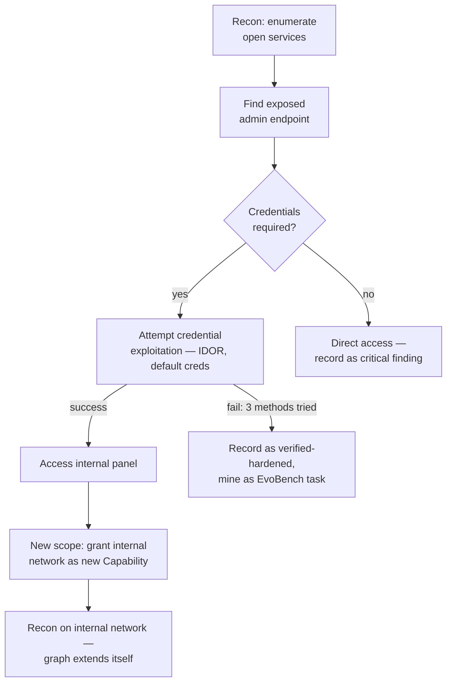

# L08 — Graph engineering: multi-target campaigns

L07's loop still runs one target at a time, in sequence. Real security
assessments rarely look like that — a single engagement touches multiple
hosts, some findings on one target unlock access to another, and the right
next step depends on what was just found, not on a fixed schedule. This
lecture is about representing *that* — a campaign, not a single task — as a
graph the harness can reason over, instead of a list the harness marches
through.

## Why a list breaks down

A task list assumes each task is independent: run task 3 whether or not
task 2 succeeded. A real campaign has dependencies — "task 3 (access the
internal admin panel) only makes sense after task 2 (find valid
credentials) succeeds," and "if task 2 fails three different ways, that's
itself worth recording as a finding, not just a blocked task." A list has
no way to express either relationship.

Node `T8` is the important one: succeeding at `T6` changes what scope
([L02](l02-scope-as-a-security-boundary.md)) the *next* node is allowed —
the graph isn't fixed upfront, it grows based on verified results, with
each new grant still going through the same deny-by-default `ScopeEnforcer`
as every other capability in this course.

## What this changes about the four subsystems

**State** carries more structure. A flat `StateStore` key per finding
([L04](l04-context-is-not-free.md)) still works, but now the harness also
needs to record the *edges* — which finding unlocked which subsequent task
— so a later session (or a human reviewing the campaign) can reconstruct
the actual attack path, not just a bag of unordered findings.

**Scope grows monotonically, never shrinks mid-campaign.** `T8` above
*adds* a capability; nothing in a sound campaign graph should *remove* one
mid-run — if a target needs to be excluded, that's a new campaign with a
smaller starting scope, not a scope that contracts while an agent is mid-
task and might be relying on access it's about to lose.

**Verification happens per-node, not just at the end.** A campaign that
only verifies its final claimed outcome can't tell you *where* in a nine-
node chain things actually went wrong. Each node needs its own
[`Verifier`](l03-verification-you-can-trust.md) call — the same discipline
as a single task, just applied at every edge instead of once.

**Lifecycle becomes per-node, with the campaign itself as the outer
session.** `SessionLifecycle.init/checkpoint/teardown` from
[L05](l05-the-four-subsystems-as-a-protocol.md) still applies to the whole
campaign, but each node benefits from its own inner checkpoint — losing
node 7 of 9 shouldn't force a restart from node 1.

## The honest caveat

Nothing in this course's current tools implements graph state directly —
[ReceiptLedger](https://github.com/Nitin13-git/receiptledger) stores
flat key-value receipts, not a graph structure. Representing the campaign
graph today means layering it on top: store each node as a receipt keyed by
a campaign-scoped id, and store edges as a separate receipt listing
`(from_node, to_node, unlocked_by)`. That works, but a purpose-built graph
store (or a thin wrapper that reconstructs the graph from receipt history)
is the natural next tool here — not yet built. This is the multi-target
analogue of [Open Problem #4](../open-problems.md) (cross-harness session
handoff): the interfaces this course defines are sound per-node, and
composing them into a graph is still manual.

**This is the last lecture in the course for now.** From here: the two
[Experiments](../experiments/e01-pallas-model-shootout.md) apply everything
to real data, and [Open Problems](../open-problems.md) lists what's left to
build — including the graph-state gap this lecture just described.
