# Open Problems

Things this course's own tools don't solve yet, written down honestly
instead of glossed over. If you want to extend this stack rather than just
use it, these are the real gaps.

```mermaid
flowchart LR
    V[Verification] --> P1[1. Verification that<br/>isn't a string match]
    V --> P3[3. Findings that need<br/>human judgment]
    S[Scope] --> P2[2. Scope that negotiates<br/>instead of being declared]
    L[Lifecycle] --> P4["4. Cross-harness session<br/>handoff (cross-language closed,<br/>cross-runtime still open)"]
    St[State] --> P4
    Meta[Meta: the benchmark itself] --> P5[5. Benchmarking<br/>the benchmark]

    style P1 fill:#3a1a1a,stroke:#ef476f
    style P3 fill:#3a1a1a,stroke:#ef476f
    style P2 fill:#2a1a3a,stroke:#7209b7
    style P4 fill:#1a2a3a,stroke:#118ab2
    style P5 fill:#2a2a1a,stroke:#ffb703
```

Four of five problems map cleanly onto one HCP subsystem each; #5
(benchmarking the benchmark) doesn't belong to any single one — it's a
property of the whole harness, not a missing interface.

## 1. Verification that isn't a string match

[EvoBench](lectures/l06-closing-the-loop-evobench.md)'s mined regression
checks are literal/pattern matches on bad output (`"5" not in text`). That
catches a model repeating the *exact* mistake, and misses a model that
makes the *same* mistake phrased differently — which, for a security
finding, is the common case: two different models producing two different
but equally-wrong "this endpoint is not vulnerable" conclusions won't share
any literal text to match against. For example, a mined task with
`bad_output="no vulnerability found"` would correctly flag a model that
repeats that exact phrase, but wave through one that instead writes "the
input is properly sanitized here" — a different wrong conclusion about the
same endpoint, invisible to a pattern match on the first model's wording. A real fix re-runs the original
reproduction (replay the HTTP request, check the actual response) instead
of pattern-matching text, but that means every mined task needs to carry an
*executable* reproduction, not just a `(prompt, bad_output)` pair — a much
bigger storage and security surface (now you're storing and re-running
arbitrary exploit code from every past session).

## 2. Scope that negotiates instead of being declared

Every tool in this course ([AgentCage](lectures/l02-scope-as-a-security-boundary.md),
[HCP](lectures/l05-the-four-subsystems-as-a-protocol.md)) assumes a human
(or an orchestrator acting on a human's behalf) declares scope *before* the
agent runs. For a task where the right scope isn't known upfront — "find
whatever's reachable from this one entry point" is inherently exploratory —
that's either too restrictive (narrow scope blocks legitimate findings) or
too late (broad scope granted after the fact defeats the point). What would
it mean for an agent to *request* an expansion of its own scope mid-task,
with that request itself independently verified before being granted,
rather than either fixing scope upfront or trusting the agent to self-limit?
Nothing in this stack answers that; [L02](lectures/l02-scope-as-a-security-boundary.md)
explicitly sidesteps it by assuming scope is known in advance.

## 3. Verifying findings that require human judgment

[L03](lectures/l03-verification-you-can-trust.md)'s whole argument depends
on the verification channel being something the agent can't fake — a flag
file, a canary, a side-channel log. That works cleanly for "did you
capture the flag." It works much less cleanly for "is this actually a
business-logic vulnerability or an intentional feature" — a judgment call
that often needs a human, or at minimum a much stronger model acting as a
reviewer. [HarnessBench](lectures/l01-why-security-harnesses-are-different.md)'s
`Task.verify` is a plain Python callable; nothing in this stack has a
pattern for "verification that sometimes has to escalate to a human in the
loop without blocking the rest of the benchmark run."

## 4. Cross-harness session handoff — cross-language closed, cross-runtime open

**Update:** [HCP's `interop/` directory](https://github.com/Nitin13-git/hcp/tree/main/interop)
now proves a narrower but real version of this: a session started by
HCP's *Python* reference SDK is resumed, continued, and verified by its
*TypeScript* reference SDK, through nothing but a shared `state.json` —
each process independently reads the other language's writes and the
script fails loudly if that doesn't actually work. That's genuine evidence
the `StateStore` and `SessionLifecycle` interfaces compose across
independent implementations, not just across copies of the same code.

**Second update:** `ScopeEnforcer` and `Verifier` interop is now proven
too, the same way — Python grants a scope and runs real `Verifier` checks,
exports both to the shared state file, and Node independently
reconstructs the scope (re-checking a case Python's script never ran, not
just replaying its answers) and confirms both `VerificationReport`s decode
with the right types. All four HCP interfaces now have a cross-language
interop test, not just two.

What's still open: all of this is cross-*language* (two reference SDKs of
the *same* protocol), not cross-*runtime* — a session started under Claude
Code, checkpointed, and resumed under a genuinely different agent tool
entirely, with `ReceiptLedger` state and `AgentCage` scope carrying over
intact, still hasn't been tested. That's a materially harder claim: it
needs two tools that weren't built together to agree on the protocol, not
two reference SDKs written by the same person to prove each other right.
The actual promise implied by calling this a protocol rather than a
library (the way MCP's value is that *any* MCP client can talk to *any*
MCP server) is closer than it was, not fully there.

## 5. Benchmarking the benchmark

[E01](experiments/e01-pallas-model-shootout.md) shows two benchmarks (005,
028) that nobody solved in that run. That's ambiguous by construction: it
could mean the benchmark is well-designed and genuinely hard, or that its
methodology has a shared bug every attempt hit. Nothing in this stack
currently distinguishes those two cases — doing so would mean benchmarking
the *benchmark itself*, likely by having a known-correct reference solution
attempt the task under the same harness and checking whether the harness
lets it succeed. That reference-solution check doesn't exist yet for any
task in this course.

---

None of these are "coming soon" promises — they're genuinely open, and
several (1 and 4 especially) are nontrivial engineering, not just missing
glue code. If you build a real answer to any of these, it's exactly the
kind of thing that belongs as a new lecture here.
