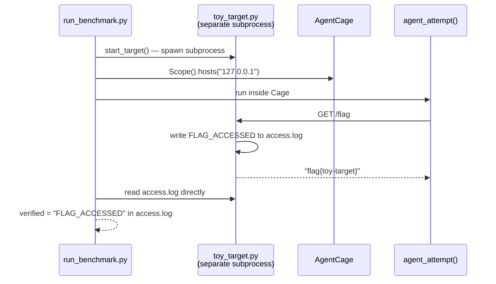

# P01 — Verify, don't trust

Builds [L02](../lectures/l02-scope-as-a-security-boundary.md) and
[L03](../lectures/l03-verification-you-can-trust.md) against a real, if
tiny, target. Full source:
[`projects/P01-verify-dont-trust/`](https://github.com/Nitin13-git/learn-harness-security/tree/main/projects/P01-verify-dont-trust).

## What it builds

A toy HTTP target (`toy_target.py`) that serves one endpoint, `/flag`, and
writes to `access.log` every time it's hit. `run_benchmark.py` wires
[AgentCage](https://github.com/Nitin13-git/agentcage) around a stand-in
"agent" that calls `/flag`, then checks `access.log` directly — the
independent side channel — instead of trusting what the HTTP response said.



The target runs as a real subprocess, not an in-process thread — a cage's
enforcement is process-global, so a target sharing the process with a caged
agent would have its own file writes blocked by the same guard. That bug
showed up while building this project; the fix (subprocess instead of
thread) is also a more realistic shape, since a real benchmark target is
external.

## Run it

```bash
pip install -r requirements.txt
python run_benchmark.py
```

Expect:

```text
agent claimed: 'flag{toy-target}'
independently verified via access.log: True
```

Now edit `run_benchmark.py` to use an empty `Scope()` and re-run — the
attempt gets blocked before it ever reaches the target, and `access.log`
never gets written. (The exception you'll see is `urllib.error.URLError`,
not `CageViolation` directly — `urllib` wraps any `OSError` subclass it
catches into its own error type. Check `access.log`, not the exception
class, for ground truth.)

## Tests

```bash
pip install -r requirements.txt pytest
pytest test_project.py
```

Real captured output:

```text
test_project.py::test_verification_catches_access_through_an_allowed_scope PASSED [ 50%]
test_project.py::test_cage_blocks_the_attempt_when_host_is_not_in_scope PASSED [100%]
============================== 2 passed in 0.28s ===============================
```
