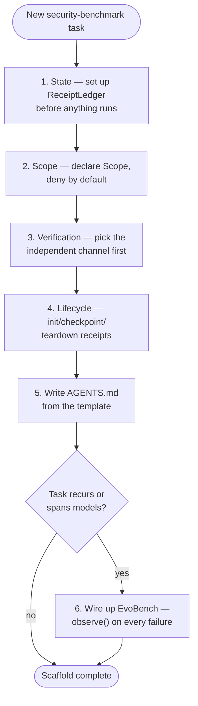

# Skills — security-harness-creator

A reusable skill: instructions an agent can follow (pasted into a system
prompt, a `SKILL.md`, or any agent-skill mechanism that accepts Markdown
instructions) to scaffold a new security-benchmark harness repo using the
stack from this course, instead of starting from a blank file every time.



```markdown
---
name: security-harness-creator
description: Scaffold a new agent harness for running and benchmarking
  models against adversarial, security-benchmark-style tasks.
---

# security-harness-creator

You are setting up a new repo where an agent will be run against
adversarial security-benchmark tasks. Follow this checklist in order; do
not skip a step because it seems redundant with a later one.

## 1. State — before anything else

Set up a durable store for findings, separate from the conversation.
Default choice: [ReceiptLedger](https://github.com/Nitin13-git/receiptledger)
— `pip install receiptledger`, then `Ledger(path)` with `.append(key,
value, by=...)`. If the task will run multiple overlapping sessions, use
`expected_prev_hash` on every write to catch two sessions clobbering the
same key.

## 2. Scope — deny by default

Before the agent runs *at all*, declare what it's allowed to touch. Default
choice: [AgentCage](https://github.com/Nitin13-git/agentcage) — build a
`Scope` granting only the specific paths, commands, and hosts this task
needs, then run everything inside `with Cage(scope):`. If you find yourself
granting `*` for any capability kind, stop — that's not a scope, write down
specifically what's needed instead.

## 3. Verification — pick the independent channel first

Before writing the task prompt, decide how success will be checked, and
make sure that check doesn't depend on anything the agent controls (a log
file it can't write to, a separately-run test, a canary value). Default
choice: [VerifyLoop](https://github.com/Nitin13-git/verifyloop) for
command-based checks (`run("pytest -q ...")` + `triage()`), or a custom
[HCP](https://github.com/Nitin13-git/hcp) `Verifier` for anything else. If
you can't describe the independent channel before the agent starts, the
task isn't ready to run yet.

## 4. Lifecycle — init, checkpoint, teardown

Wrap the session: write a `"status": "init"` receipt before the agent
starts, checkpoint after any meaningful milestone (not just at the end —
sessions get interrupted), and write a `"status": "teardown:<reason>"`
receipt when it stops, whether that's success, failure, or a timeout.

## 5. Write AGENTS.md from the template

Copy [`resources/AGENTS.md`](../resources.md) into the new repo and fill in
the bracketed sections with this task's actual scope, verification method,
and state file path — don't leave placeholders in a file the agent will
actually read.

## 6. If this task will recur, wire up EvoBench

If this is one of a *family* of similar tasks (same target class, repeated
over time, or benchmarked across models), don't stop at step 4. Any failure
this harness catches is a candidate regression task — call
`evobench.observe(suite, task_id=..., prompt=..., bad_output=..., run_result=...)`
on it, so the next run — on this model or a different one — gets checked
against it automatically. See
[L06](../lectures/l06-closing-the-loop-evobench.md) for why this matters
more for security tasks than cooperative ones.

## Output

A repo with: a `Scope` declared before any agent code runs, a durable
ledger for findings, an independent verifier wired in before the task
prompt is written, lifecycle receipts bracketing the session, a filled-in
`AGENTS.md`, and (if applicable) an EvoBench suite that grows with every
real failure. Do not report the scaffold "done" until all of the above are
in place — a harness missing even one of these four subsystems is not a
smaller version of a complete harness, it's a different, weaker thing.
```

This mirrors [walkinglabs' `harness-creator` skill](https://walkinglabs.github.io/learn-harness-engineering/en/)
in shape — a step-by-step scaffolding checklist an agent follows — but the
steps themselves are specific to the adversarial case this course covers,
not a copy of theirs.
